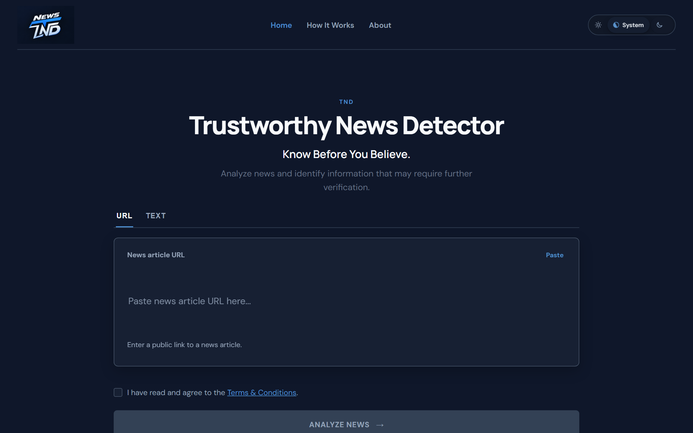
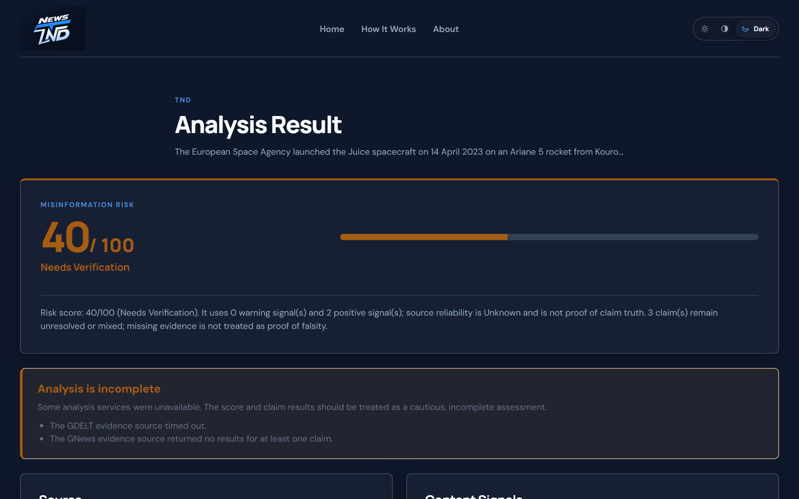
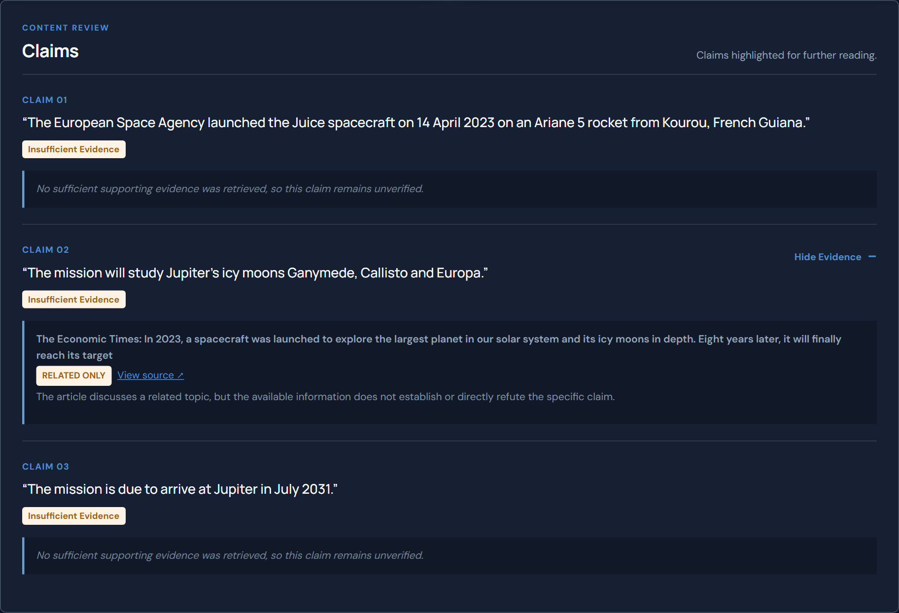
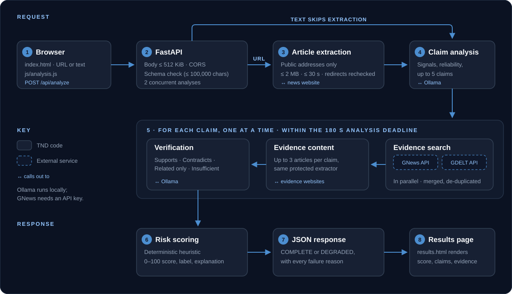

<p align="center">
  
</p>

<p align="center">
  
  
  
  
  
  
  
</p>

**TND (The News Detector)**, shown in the app as *Trustworthy News Detector*,
gives readers a second look at a news article before they believe or share it.
Paste a URL or the article text. A local language model identifies the
article's content signals and factual claims. TND then searches GNews and
GDELT for related coverage and checks each claim against the evidence it
actually retrieved. You receive an explainable **heuristic** risk score, the
claims, the evidence behind each assessment, and a plain list of anything that
failed along the way.

> [!IMPORTANT]
> TND does not decide what is true. Its score is a warning indicator, not a
> probability, and *insufficient evidence* is never treated as proof that a
> claim is false. Always read the evidence and consult the original sources.

## Contents

[Screenshots](#screenshots) · [Features](#features) · [How it works](#how-it-works) ·
[Project structure](#project-structure) · [Requirements](#requirements) ·
[Setup](#installation-and-local-setup) · [Configuration](#environment-variables) ·
[API](#api-reference) · [Understanding results](#understanding-results) ·
[Testing](#testing) · [Security](#security-and-responsible-use) ·
[Limitations](#limitations) · [Roadmap](#roadmap)

## Screenshots

<table>
  <tr>
    <td width="50%"></td>
    <td width="50%"></td>
  </tr>
  <tr>
    <td align="center"><sub>Home: analyze a URL or pasted text</sub></td>
    <td align="center"><sub>Results: score, explanation, and why the analysis is incomplete</sub></td>
  </tr>
</table>

<p align="center">
  
  <br />
  <sub>Claim-level review. Real output for a short demonstration text: GDELT timed out and GNews found one related article, so every claim stays <em>Insufficient Evidence</em> rather than being called false.</sub>
</p>

## Features

| | |
|---|---|
| **Text and URL analysis** | Analyze pasted text, or a public article URL whose text and metadata (title, publisher, author, date) are extracted for you. |
| **Claim extraction** | A local Ollama model identifies content signals and up to five specific, checkable claims. |
| **Evidence retrieval** | Each claim is searched in GNews and GDELT in parallel, with provenance preserved and duplicates merged. |
| **Claim verification** | Retrieved evidence is classified as supports, contradicts, related only, or insufficient, with an explanation. |
| **Explainable risk score** | A deterministic 0–100 heuristic with a written explanation of what moved it. |
| **Honest degradation** | Provider, model, extraction, and time-limit failures are listed instead of hidden. |
| **Insufficient evidence ≠ false** | Missing evidence is reported as unresolved, never as a refutation. |
| **Themes** | Light, dark, and system themes, remembered across pages. |

## How it works

<p align="center">
  
</p>

1. **Browser.** The user submits a URL or text; `js/analysis.js` posts
   `{ "type": "url" | "text", "content": "..." }` to `POST /api/analyze`.
2. **FastAPI.** The request passes a 512 KiB body limit, CORS, schema
   validation (1–100,000 characters), and a limit of two concurrent analyses.
3. **Article extraction (URLs only).** The destination must resolve to a public
   address. The HTML is fetched with size (2 MB) and time (30 s) limits, every
   redirect is re-validated, and the text is extracted with Trafilatura, then
   JSON-LD `articleBody`, then a constrained `<article>`/`<main>` fallback.
4. **Claim analysis.** Ollama reads the first 12,000 characters and returns
   content signals, a source-reliability estimate (always `Unknown` for pasted
   text), and up to five claims.
5. **Per-claim evidence loop.** Claims are processed one at a time within the
   overall deadline (180 s by default). GNews and GDELT are queried in
   parallel; up to three evidence articles are fetched through the same
   protected extractor; Ollama classifies each article against the claim.
6. **Risk scoring.** A deterministic heuristic combines signals, source
   reliability, and claim statuses into a score, label, and explanation.
7. **Response.** The JSON is `COMPLETE` or `DEGRADED`, with every failure
   reason listed.
8. **Results page.** The browser stores the response in `sessionStorage` and
   renders it on `results.html`.

<details>
<summary><b>Evidence retrieval and verification details</b></summary>

**Retrieval.** For each extracted claim, TND sends a bounded, deterministic
search query to the configured GNews and GDELT providers. Important claim
words, entities, numbers, negation, attribution, and causal qualifiers are
retained; the application does not rewrite the original claim based on search
results. Provider failures, missing configuration, empty results, rate limits,
and malformed responses are reported separately in `degradationReasons`.
GNews and GDELT responses are streamed and capped at 512 KiB before parsing.
GDELT redirects are treated as provider failures, not followed.

Results preserve provider provenance, the original claim context, source URL,
valid publication dates, and headline-versus-article-text status. HTTPS and
metadata completeness are transparent indicators only, not editorial
credibility or truth scores. Equivalent URLs are deduplicated conservatively;
when both providers return one article, their provenance is retained and
independence remains `UNKNOWN` rather than counting two confirmations.

**Verification.** Each claim is verified independently against the evidence
returned for that claim. Topical overlap, publisher reputation, and a missing
article body cannot establish truth or falsity; without retrieved article text,
evidence cannot be classified as supporting or contradicting. Duplicate URLs
and exact syndicated article text are assessed once and marked `SAME_ARTICLE`
rather than counted as independent corroboration. Malformed or fabricated
model references never create evidence or upgrade a claim.

**Inference.** Each Ollama stage makes one bounded request with no automatic
retries. Connection, timeout, HTTP, model-availability, empty-output, and
malformed-JSON failures are classified internally and exposed only as
sanitized degradation reasons.

</details>

## Project structure

```text
TND-The-News-Detector/
├── backend/
│   ├── app/
│   │   ├── main.py              # FastAPI app: CORS, body limit, error handling, /api/health
│   │   ├── routes/analysis.py   # POST /api/analyze, concurrency limit, HTTP error mapping
│   │   ├── models/schemas.py    # request and response schemas
│   │   └── services/
│   │       ├── article_extractor.py   # protected URL fetch and article extraction
│   │       ├── analyzer.py            # analysis orchestration and risk scoring
│   │       ├── evidence_retriever.py  # GNews and GDELT search
│   │       ├── evidence_content.py    # fetches evidence article text
│   │       ├── evidence_verifier.py   # claim-versus-evidence assessment
│   │       ├── ollama_client.py       # bounded Ollama requests
│   │       └── ollama_config.py       # environment configuration
│   ├── tests/                   # pytest suite (external services mocked)
│   └── requirements.txt
├── frontend/
│   ├── index.html               # analyzer
│   ├── results.html             # results
│   ├── about.html, terms.html
│   ├── css/style.css
│   └── js/
│       ├── analysis.js          # API client and response validation
│       └── main.js              # input, themes, results rendering
├── tests/
│   ├── ui.spec.js               # Playwright UI suite (mocked API)
│   └── live/                    # Playwright live suite (real services)
├── docs/                        # release plan and README assets
├── .github/workflows/playwright.yml
├── playwright.config.js
├── package.json
└── .env.example
```

## Requirements

| Requirement | Notes |
|---|---|
| **Python** | 3.10 or newer (the code uses 3.10 syntax). Developed and tested on Python 3.14. |
| **Ollama** | Installed and running locally, from [ollama.com](https://ollama.com). |
| **Ollama model** | `llama3.2:3b` by default (configurable). |
| **GNews API key** | Optional, from [gnews.io](https://gnews.io). Without it, only GDELT is searched and the result says so. |
| **Internet access** | For URL analysis and evidence retrieval. Pasted text still needs it for evidence. |
| **Node.js and npm** | Only for the Playwright tests. Tested with Node.js 24 and npm 11. |

## Installation and local setup

Commands are for Windows PowerShell, run from the repository root unless noted.

**1. Clone and create the backend environment**

```powershell
git clone https://github.com/lloydaq/TND-The-News-Detector.git
cd TND-The-News-Detector
cd backend
python -m venv .venv
.\.venv\Scripts\Activate.ps1
pip install -r requirements.txt
cd ..
```

**2. Configure**

```powershell
Copy-Item .env.example .env
```

Edit `.env` and set `GNEWS_API_KEY` to your own key, or leave it empty to use
GDELT only. `.env` is local configuration: it is ignored by Git and must never
be committed, shared, or pasted into issues.

**3. Install the model**

```powershell
ollama pull llama3.2:3b
ollama list   # confirm the model is installed
```

**4. Start the backend** (terminal 1)

```powershell
cd backend
.\.venv\Scripts\Activate.ps1
uvicorn app.main:app --reload
```

The API runs at `http://127.0.0.1:8000`, with interactive docs at
`http://127.0.0.1:8000/docs`.

**5. Start the frontend** (terminal 2, repository root)

```powershell
python -m http.server 5500 --bind 127.0.0.1 --directory frontend
```

Open **`http://127.0.0.1:5500/index.html`**.

> [!NOTE]
> Opening `index.html` directly from disk (`file://`) does not work: the
> browser sends a `null` origin, which the backend's CORS policy rejects. The
> frontend calls the API at `http://127.0.0.1:8000`; to serve it from another
> origin, add that origin to `ALLOWED_ORIGINS`.

## Environment variables

Settings are read from the environment; a `.env` file in the repository root is
loaded automatically. Invalid or non-positive numbers fall back to the default.

| Variable | Required | Default | Purpose |
|---|---|---|---|
| `GNEWS_API_KEY` | No | *(empty)* | GNews key. When empty, GNews is skipped and reported as not configured. |
| `OLLAMA_URL` | No | `http://127.0.0.1:11434/api/generate` | Ollama generate endpoint. |
| `OLLAMA_MODEL` | No | `llama3.2:3b` | Model for analysis and verification; must be pulled in Ollama. |
| `OLLAMA_TIMEOUT_SECONDS` | No | `60` | Limit for one Ollama request. |
| `MAX_ANALYSIS_SECONDS` | No | `180` | Overall deadline for one analysis, including verification. |
| `MAX_CONCURRENT_ANALYSES` | No | `2` | Analyses allowed at once; extra requests get HTTP 503. |
| `ALLOWED_ORIGINS` | No | *(empty)* | Extra comma-separated CORS origins, added to `http://localhost:5500`, `http://127.0.0.1:5500`, `http://localhost:3000`, and `http://127.0.0.1:3000`. |

## API reference

### `GET /api/health`

Returns `{"status": "ok", "service": "TND Backend"}` while the API process is
running. It does **not** check Ollama or the evidence providers.

### `POST /api/analyze`

```powershell
curl.exe -X POST http://127.0.0.1:8000/api/analyze `
  -H "Content-Type: application/json" `
  -d '{\"type\": \"text\", \"content\": \"The council approved the budget on Monday.\"}'
```

| Field | Type | Notes |
|---|---|---|
| `type` | `"url"` or `"text"` | Required. |
| `content` | string | Required; 1–100,000 characters after trimming. |

A successful response contains:

| Field | Description |
|---|---|
| `title`, `source`, `publisher`, `author`, `publishedAt` | Article metadata (for pasted text: `Provided Text`, `User Provided`). |
| `riskScore`, `riskLabel` | Heuristic score from 0 to 100, and its label. |
| `sourceReliability` | `Unknown`, `Low`, `Moderate`, or `High`. |
| `signals` | `{ name, status }`, where status is `positive`, `warning`, or `unknown`. |
| `claims` | `{ id, text, status, verificationStatus, evidence[] }`; each evidence item has `source`, `description`, `url`, `relevance`, `explanation`, and provenance fields. |
| `analysisStatus` | `COMPLETE` or `DEGRADED`. |
| `degradationReasons` | Readable reasons for anything that failed. |
| `analysisExplanation` | Plain-language account of the score. |

The full schema is at `http://127.0.0.1:8000/docs`. Errors return
`{"detail": "<message>"}` without internal details:

| Status | Meaning |
|---|---|
| 400 | Invalid or disallowed URL (not HTTP(S), embedded credentials, private or reserved address). |
| 413 | Request body larger than 512 KiB. |
| 422 | Invalid request (empty or too-long content, invalid JSON), or no article content could be extracted. |
| 500 | Unexpected failure; details are logged on the server only. |
| 502 | The external webpage could not be fetched. |
| 503 | Too many analyses are running. |

## Understanding results

**The risk score is a heuristic, not a probability.** A score of 70 does not
mean a 70% chance that the article is false, and a high score is not proof of
misinformation. The score starts neutral at 50. Warning signals raise it and
positive signals lower it; the source-reliability estimate adjusts it; a
contradicted claim raises it sharply (any contradiction keeps it at 70 or
above); supported claims lower it. When claims exist but none is supported,
the score stays at 40 or above, so missing evidence never produces false
confidence.

| Score | Label |
|---|---|
| Below 30 | Low Risk |
| 30–69 | Needs Verification |
| 70 and above | High Risk |

**Claim statuses describe the evidence TND found, not the truth.**

| Status | Meaning |
|---|---|
| `SUPPORTED` | Retrieved evidence directly supports the claim. |
| `CONTRADICTED` | Retrieved evidence directly contradicts the claim. |
| `MIXED` | The evidence points both ways. |
| `INSUFFICIENT_EVIDENCE` | No decisive evidence was found. **This does not mean the claim is false.** Often the providers simply returned nothing relevant. |
| `UNVERIFIABLE` | Verification itself failed, for example because the model timed out or returned unusable output. |

Failing to find supporting evidence says nothing about the reliability of the
article's source.

**`DEGRADED` means incomplete.** The results page lists each reason, such as a
provider timing out or returning no results, the article being only partly
extracted, or long content being cut to its first 12,000 characters. Treat the
result as partial.

**Not assessed.** When an analysis produced no signals and no claims (for
example, because Ollama was unreachable), the page shows "Not assessed" instead
of a score.

Automated analysis is a starting point for verification, not a replacement for
it. Read the evidence, open the sources, and use your own judgement.

## Testing

**Backend**: run from `backend` with the virtual environment active. External
services are mocked, so no network, Ollama, or API key is needed.

```powershell
python -m pytest -q -rs
python -m compileall -q app tests
```

**Browser UI**: run from the repository root. The API is mocked and the
frontend server starts automatically. Runs in Chromium, Firefox, WebKit, and
mobile Chromium.

```powershell
npm ci
npx playwright install
npm run test:e2e
```

**Live integration**: uses the real backend, Ollama, and the evidence
providers. Start the backend and Ollama first; it takes a few minutes, and
provider outages produce honestly degraded results rather than failures.

```powershell
npm run test:e2e:live
```

<sub>Last verified on 19 October 2026, during v1.0.0 release preparation: 159
backend tests, 132 UI test runs (33 tests × 4 browser projects), and 3 live
tests passed. These are historical figures; run the commands for current
results.</sub>

## Security and responsible use

* **Secrets.** The GNews key lives only in your local `.env`, which Git
  ignores. Never commit it or put it in shared commands.
* **URL fetching.** User-submitted URLs are a security boundary. Destinations
  must be HTTP(S) without embedded credentials and must resolve to globally
  routable addresses: loopback, private, link-local, shared (100.64.0.0/10),
  and cloud-metadata addresses are rejected, including IPv4-mapped and NAT64
  forms. Connections are pinned to the validated address, every redirect is
  re-validated, and responses are limited in size and time.
* **Request limits.** Bodies over 512 KiB are rejected, content is capped at
  100,000 characters, and at most two analyses run at once.
* **Errors and rendering.** API errors never include stack traces or the
  submitted content. The frontend renders article and evidence text as text,
  never as HTML, and links only HTTP(S) evidence URLs.
* **Scope.** These are engineering safeguards covered by the test suite, not a
  formal security certification. Public deployment needs additional controls
  (see [Limitations](#limitations)).
* **Responsible use.** TND highlights what deserves a closer look. Treat its
  output as one input to your judgement, inspect the evidence, and consult
  original and independent sources before acting on or sharing a story.

## Limitations

* Extraction cannot execute JavaScript, bypass paywalls, or recover content
  that a website does not send in its HTML response. Websites may block
  requests or return unsupported content; these are reported as errors, not
  treated as article text.
* Short, metadata-only, navigation-heavy, and boilerplate-only pages are
  rejected or reported as partial.
* Only the first 12,000 characters of long content are analyzed; the result is
  marked `DEGRADED` when this happens.
* Evidence coverage depends on GNews and GDELT. GDELT timeouts and empty
  results are common, which leaves many claims at `INSUFFICIENT_EVIDENCE`.
  A missing `GNEWS_API_KEY` disables GNews only.
* Search ranking, HTTPS, publisher names, and result counts do not measure
  source reputation or truthfulness. Syndicated copies may not be independent.
* Output quality depends on the local model. `llama3.2:3b` is small; it can
  miss claims or misjudge evidence.
* For URL input, the model's source-reliability estimate affects the score. It
  is a heuristic judgement, not a measured reputation.
* An analysis typically takes tens of seconds and can take up to the
  180-second deadline.
* `/api/health` reports only that the API process is running.
* The concurrency limit is per process; there is no distributed rate limiter.
  A public or multi-worker deployment needs rate limiting and body limits at
  the reverse proxy or gateway, and its origin in `ALLOWED_ORIGINS`. Local
  development is the current deployment assumption.

## Roadmap

* [x] Bounded evidence retrieval pipeline.
* [x] GNews and GDELT as provenance-preserving evidence sources.
* [x] Supported, contradicted, mixed, insufficient, and unverifiable claim statuses.
* [x] Error handling and article extraction improvements.
* [x] Frontend connected to live backend analysis.
* [x] Automated tests for API endpoints and article extraction.
* [x] Playwright browser tests (mocked UI suite and live integration suite).
* [ ] Deployment and configuration improvements.

v1.0.0 release preparation is in progress; see
[`docs/phase-3-release.md`](docs/phase-3-release.md).

## Contributing

Issues and pull requests are welcome.

* **Bugs.** Include the steps to reproduce, the input type (URL or text), what
  you expected, and what happened. Never include your `.env` or API key.
* **Changes.** Keep pull requests focused, add or update tests for behaviour
  changes, and run the backend and UI test suites before submitting.

## License

No license has been specified for this repository yet.

## Disclaimer

TND is an experimental project. Its analysis is a heuristic aid and should not
be relied upon to determine whether a news article is true or false.

## Author

**Lloyd D'Souza** · GitHub: [lloydaq](https://github.com/lloydaq)

<p align="center">
  
</p>
